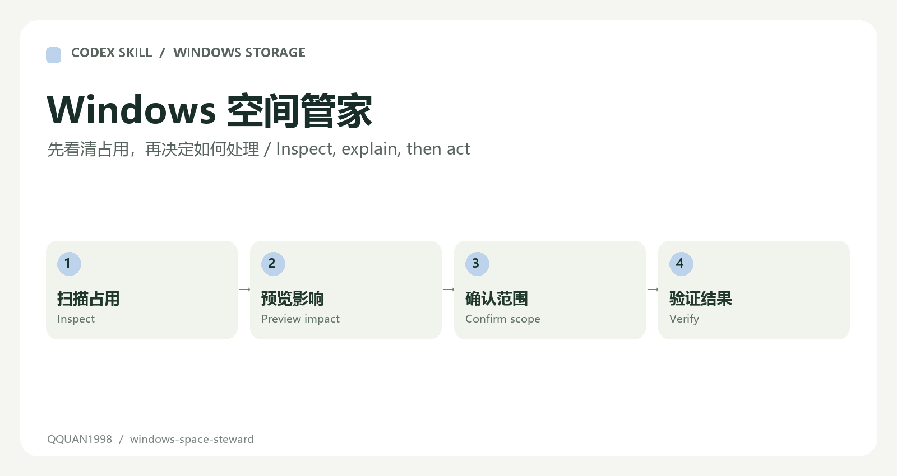

# Windows Space Steward

[简体中文](README.md)



A Codex skill for understanding disk pressure, previewing cleanup, planning C-to-D migration and finding true duplicates while preserving access to retained files.

## What it does

| Task | Approach |
| --- | --- |
| Inspect storage | Identify drive capacity, large folders and cache hotspots |
| Preview cleanup | Show target, size, risk and impact before any action |
| Plan migration | Choose shortcuts, junctions or the application's own settings where appropriate |
| Find duplicates | Group by size, then compare SHA-256; filenames alone are insufficient |
| Preserve traceability | Create a desktop retained-file index and handling records |

## Workflow

1. Scan the requested drives and identify the main sources of pressure.
2. List cleanup/migration candidates with risks and expected impact.
3. Present duplicate groups and let the user choose what to keep.
4. Confirm the exact scope, execute the smallest approved action and verify free space.
5. Create shortcuts and a report so retained files remain discoverable.

## Install and use

```powershell
Copy-Item -Recurse .\windows-space-steward "$env:USERPROFILE\.codex\skills\windows-space-steward"
```

Restart Codex, then ask:

```text
Use $windows-space-steward to inspect my C and D drives,
preview cleanup and migration options, and explain their impact.
Wait for my confirmation before making changes.
```

Start with [the skill](windows-space-steward/SKILL.md), [impact matrix](windows-space-steward/references/impact-matrix.md) and [migration rules](windows-space-steward/references/migration-rules.md). The scripts default to preview/dry-run; execution requires a specific approved scope.

## Protected data

Do not directly move or remove Windows/system-managed directories, installed programs, active projects, WPS sync data, WeChat history, browser credentials, Lenovo AppData or active Codex worktrees. Use application-managed migration for managed data. Do not clean active Codex runtime/tmp caches. Never claim all cache deletion is harmless.

This refresh changes documentation and adds the workflow image only. It does not run cleanup, remove files or change the computer's settings.
